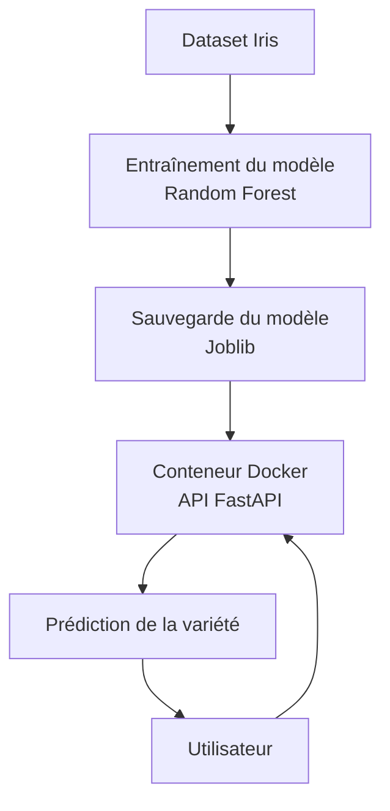

# Architecture

## Diagramme

### Entrée et API
L'utilisateur envoie les quatre mesures au format JSON sur l'API exposée par Docker Compose. FastAPI valide les types et les valeurs strictement positives avant toute prédiction. Docker Compose construit l'image depuis le Dockerfile, crée le conteneur de l'application et publie l'API sur le port 8000.

### Modèle
Le modèle doit être entraîné avant la construction de l'image Docker. Il est chargé depuis une sauvegarde locale `model/iris_model.joblib`, puis copie avec le reste du projet dans l'image.

### Entraînement
Avant le lancement de Docker, il faut créer et activer l'environnement virtuel, installer les dépendances avec `pip install -r requirements.txt`, puis lancer `python scripts/train.py`. Le script charge les données, réalise une division stratifiée, optimise les hyperparamètres du Random Forest et valide le modèle sur un jeu de test. Il crée ensuite `model/iris_model.joblib`. Cette étape est réalisée localement et Docker ne relance pas automatiquement l'entraînement.

### CI/CD
Après l'entraînement, le Dockerfile installe les dépendances Python, copie le code et le fichier `iris_model.joblib` dans l'image, puis lance Uvicorn avec FastAPI. Docker Compose construit ensuite cette image et l'exécute sur le port 8000. Une fois le modèle présent, les commandes de démarrage sont `docker compose build` puis `docker compose up -d`, elles doivent être relancées après chaque modification du modèle ou du code.
